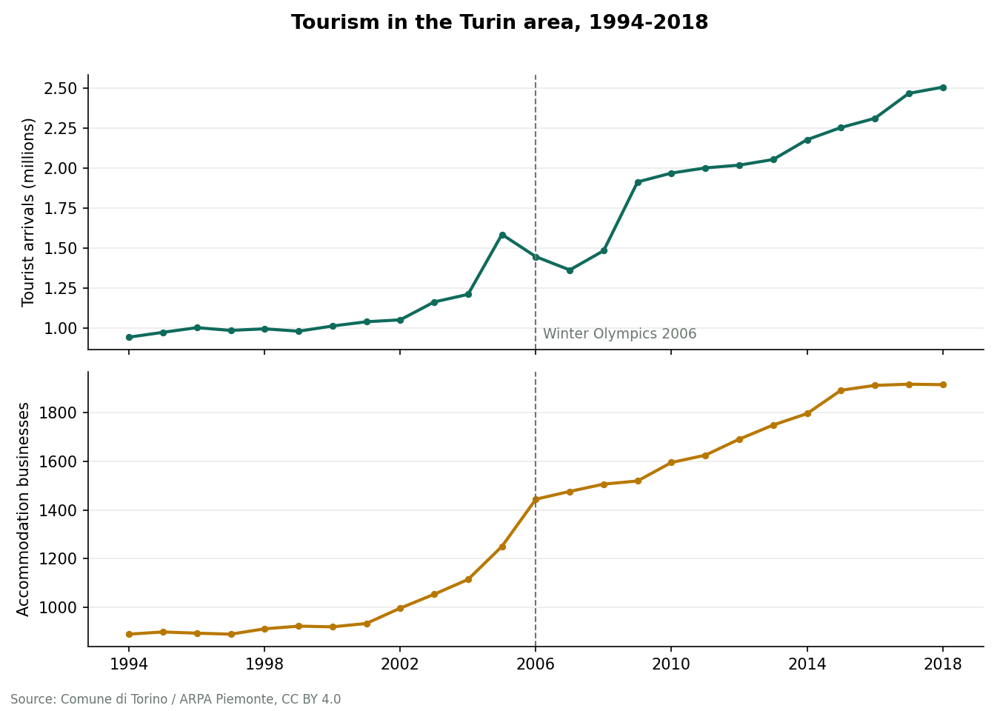
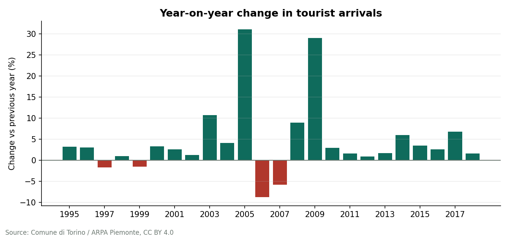

# Turin Tourism Trends, 1994-2018


A small data pipeline and SQL analysis of two public Open Data Torino series: the number of tourist accommodation businesses and the number of tourist arrivals in the Turin area, 1994-2018.

Raw CSV files go in, get cleaned and validated with **Python and pandas**, are loaded into a **SQLite** database with constraints, and are analysed with **SQL** (window functions, CTEs, a view). The pipeline produces charts and a findings report, and is covered by **47 automated tests**.



## What I found

All numbers are generated by the pipeline into [`outputs/findings.md`](outputs/findings.md).

- Arrivals grew from **941,970 (1994) to 2,505,985 (2018)**, an increase of 166%, or about 4.2% a year.
- Accommodation businesses grew from **890 to 1,916** (+115%, about 3.2% a year), so arrivals grew faster than supply. Arrivals per business rose from about 1,058 to 1,308.
- Arrivals fell year-on-year only in **1997, 1999, 2006 and 2007**.
- The two largest jumps are **+31.0% in 2005** and **+29.0% in 2009**. The data do not explain them, so I do not attribute causes (see Limitations).



## Data

| Series | Source file |
|---|---|
| Tourist accommodation businesses (Esercizi turistici 1994-2018) | `esercizi_turistici_provTO_1994-2018.csv` |
| Tourist arrivals (Arrivi turisti 1994-2018) | `arrivi_turisti_provTO_1994-2018.csv` |

Published on [aperTO](https://aperto.comune.torino.it) by the City of Turin; original indicators by ARPA Piemonte. Licence: **CC BY 4.0**. Copies of the files are included in `data/raw/` so the project runs offline.

### Data quality problems handled

- **Italian thousands separator.** `1.054` means 1,054, not 1.054. Reading the file normally would silently produce wrong numbers.
- **Inconsistent formatting in one file.** The businesses series uses dots up to 2015 (`1.893`) but none from 2016 (`1913`).
- **A trailing zero that must survive:** `1.520` is 1,520, and a float conversion would give 1.52.
- **Windows (CRLF) line endings** in the raw files.

The parser accepts only plain digits or digits grouped by dots every three places, and raises an error for anything else. The cleaning step also checks that years are unique and consecutive and that values are positive.

## How it works

```
data/raw/*.csv  ->  tourism/clean.py  ->  SQLite (sql/schema.sql)  ->  sql/analysis.sql  ->  charts + findings
```

SQL used in `sql/analysis.sql`: `LAG()` window functions for year-on-year change, CTEs, a joined view (`tourism_yearly`), `GROUP BY` on computed five-year blocks, and conditional columns. The tables use primary keys and `CHECK` constraints, so bad data cannot get in even if it bypasses the Python code.

## Run it

Requires Python 3.10+.

```bash
python -m venv .venv && source .venv/bin/activate    # Windows: .venv\Scripts\activate
pip install -r requirements.txt
python -m tourism        # builds build/tourism.sqlite and writes outputs/
pytest                   # 47 tests
```

To refresh the raw files from the source: `python scripts/download_data.py`.

## Tests

The tests cover the number parser (including the formatting traps above), validation of bad input, the database constraints, and the analysis. The SQL results are **cross-checked against independent pandas calculations**, so a query cannot pass by agreeing with itself.

## Project structure

```
tourism/
  clean.py       parsing and validation
  database.py    builds the SQLite database
  analysis.py    runs named SQL queries; compound growth rate
  report.py      charts and findings.md
sql/             schema.sql, analysis.sql
data/raw/        source CSV files
outputs/         generated charts and findings
tests/           pytest suite
```

## Limitations

- The figures are for the **Province of Turin**, not the city alone.
- The dataset contains totals only and does not document why the series jumps in 2005 and 2009. It could be real events or a change in how the indicator is measured, so the analysis reports the jumps without explaining them. The 2006 Winter Olympics are marked on the chart for reference only. The data do not show that the Games caused any change.
- The series ends in 2018.
- Arrivals per business means busier businesses on average, not occupancy or profit.

## Ideas for next

- Add the portal's related series (average length of stay, beds per 100 residents) for a richer picture
- Build an interactive dashboard on top of the SQLite database
